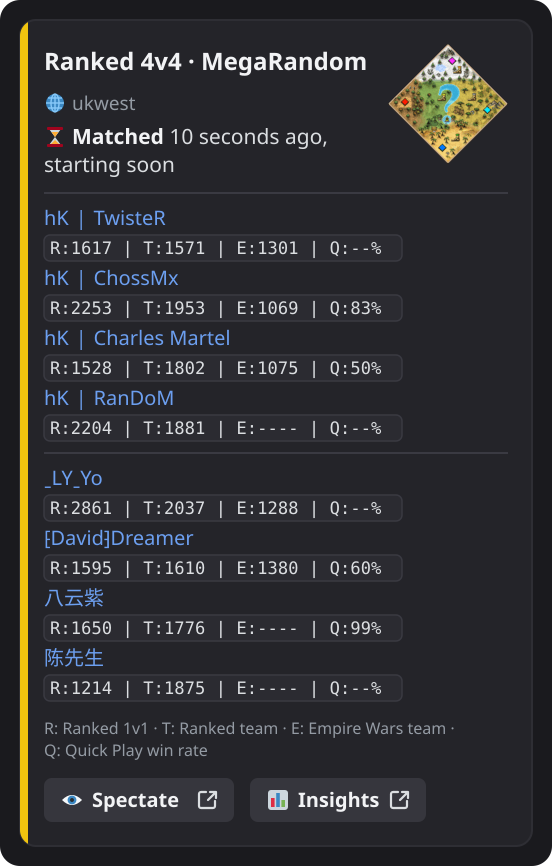
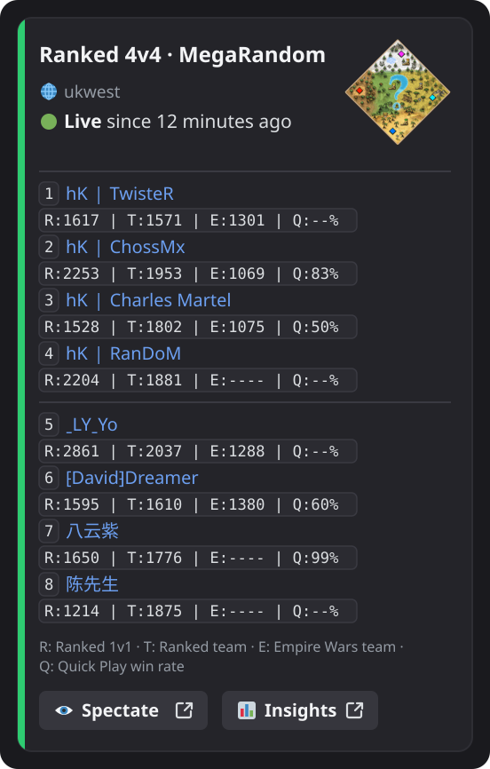
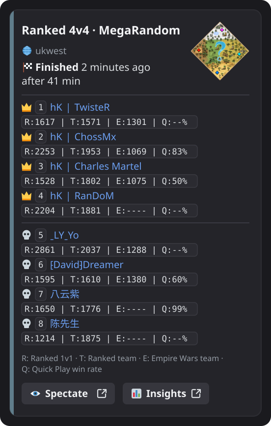

# Age of Empires MatchBot


Discord bot that posts Age of Empires II: DE matches of tracked players as soon as they are matched, before the game starts.

| Matched, before the game starts | Live, with player numbers | Finished, with the result |
|:---:|:---:|:---:|
|  |  |  |

## Quickstart

**Prerequisites:**
- Discord Bot Account (see step 1 below)
- Steam account that owns **Age of Empires II: DE** with deactivated Steam Guard (2FA)
- Docker Engine installed on your system/server

> [!IMPORTANT]
> Without a Steam Account that owns **Age of Empires II: DE**, this bot does not work!

> [!CAUTION]
> I strongly recommend you create a secondary Steam account and gift it the base game. As without 2FA your main account is just a password leak away from being compromised.

1. [Create a Bot Account](https://discordpy.readthedocs.io/en/stable/discord.html) in the [Developer Portal](https://discord.com/developers/applications). Open **Bot** and copy the token (**Reset Token**); it goes into `DISCORD_TOKEN` below. Then invite the bot to your server via **OAuth2 → URL Generator** with Scopes and Bot permissions as follows:
   - Scopes
      - `bot`
      - `applications.commands`
   - Bot Permissions
      - View Channels
      - Send Messages
      - Embed Links
      - Read Message History
      - Create Public Threads
      - Send Messages in Threads

2. Create a folder with a `.env` file:

   ```
   DISCORD_TOKEN=<The token you copied earlier>
   STEAM_USERNAME=<Steam account name>
   STEAM_PASSWORD=<Steam password>
   ```

3. Add a `compose.yaml` next to it:

   ```yaml
   services:
     matchbot:
       image: ghcr.io/teasit/discord-aoe2-matchbot:latest
       container_name: matchbot
       restart: unless-stopped
       volumes:
         - ./:/app/data
   ```

4. Start it with `docker compose up -d`. Logs: `docker logs matchbot`. The bot's status shows its version, plus the newest one when an update is available; update with `docker compose pull && docker compose up -d`.

5. In Discord, run `/join` in the channel for match posts and `/add <player_id>` for each player to track (SteamID64 or Relic Link profile ID).

## Commands

| Command | Description |
|---|---|
| `/join` | Posts matches of tracked players in this channel. |
| `/leave` | Stops posting matches in this channel. |
| `/add <player_id>` | Tracks a player by SteamID64 or Relic Link profile ID. |
| `/remove <player_id>` | Stops tracking a player (SteamID64 or Relic Link profile ID). |
| `/list` | Lists tracked and banned players with their SteamID64. |
| `/set_elo_max_diff <max_diff>` | Warns in a thread when the 1v1 Elo of the teams' best players differs by more than this and a tracked player is on the weaker team (per channel, `0` = off). |
| `/set_smurf_max_diff <max_diff>` | Warns in a thread when a player other than the tracked ones is more than this below their all-time high 1v1 Elo, a hint at a smurf account (per channel, `0` = off). |
| `/ban <player_id> [comment]` | Adds a player to the banlist by SteamID64 or Relic Link profile ID; posts with this player get a warning thread. |
| `/unban <player_id>` | Removes a player from the banlist (SteamID64 or Relic Link profile ID). |

## License

Copyright (C) 2026 Tom Teasdale

This program is free software: you can redistribute it and/or modify it under the terms of the GNU General Public License as published by the Free Software Foundation, either version 3 of the License, or (at your option) any later version. It is distributed in the hope that it will be useful, but WITHOUT ANY WARRANTY; without even the implied warranty of MERCHANTABILITY or FITNESS FOR A PARTICULAR PURPOSE. See [LICENSE](LICENSE) for details.

Age of Empires II: Definitive Edition © Microsoft Corporation. This project is not affiliated with or endorsed by Microsoft, Relic Entertainment, World's Edge, Valve or aoe2companion. Map names are read from the game's own files at runtime; the bundled `src/matchbot/maps/map_names.json` fallback contains map names from the game's string table.

## Development

Architecture, modules and how to run or build the bot yourself: [DEVELOPERS.md](DEVELOPERS.md).
